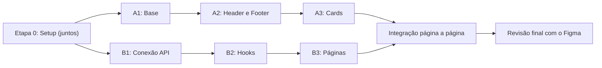

# Plano de Desenvolvimento — Frontend Arte Digital Floripa

> Referências: [ARQUITETURA_COMPONENTES_FRONTEND.md](./ARQUITETURA_COMPONENTES_FRONTEND.md) · Figma `Screens (0:1)` e `Fluxograma Componentes (4181:920)`
> Stack: React 19 + Vite + react-router-dom 7 + axios · CSS centralizado em `src/styles/`

---

## Divisão do trabalho

| Trilha | Responsável | Foco | Por quê |
| :--- | :--- | :--- | :--- |
| **A — Componentes** | Dev | Componentes visuais "burros" (recebem props, não buscam dados) + CSS | Mais simples: só markup + estilo, dá pra conferir direto no Figma |
| **B — Dados & Páginas** | Mateus | API, hooks, páginas, montagem das seções, casos especiais | Mais complexo: integração com backend, estado, regras de layout |

As duas trilhas andam **em paralelo** porque o contrato entre elas (as props de cada componente) já está definido na seção 3. O Dev não precisa esperar a API, e o Mateus não precisa esperar o visual final.



---

## Etapa 0 — Setup (juntos, ~30 min)

- [ ] Subir a branch `feat/nova-arquitetura-front` (comandos no final)
- [ ] Os dois clonam/puxam a branch, rodam `npm install` e `npm run dev` em `frontend/`
- [ ] Backend rodando em `http://localhost:3000` (`npm run dev` no `backend-artedigital-mock`)
- [ ] Combinar a convenção: **todo CSS vai em `src/styles/components.css`**, cada componente no seu bloco com cabeçalho de comentário. Cada um só edita os blocos da própria trilha (evita conflito de merge)
- [ ] Limpeza de nomes (ver "Pendências encontradas" no final)

---

## Trilha A — Dev (Componentes)

Regra de ouro: **componente não chama API**. Recebe tudo por props e devolve markup. Testar com dados fixos dentro da própria página enquanto a Trilha B não termina.

### A1 — Componentes base (`components/common/`)
- [ ] `Button` — variantes `primary` (terracota), `outline`, `dark`; aceita `as="a"`/link
- [ ] `FilterTag` — estado `active`; altura 37px; formato pílula
- [ ] `SearchInput` — input + botão "Buscar"; dispara `onSearch`
- [ ] `SectionDivider` — linha `--color-divider-section`
- [ ] `MetricBadge` — valor grande (Jomolhari) + rótulo (Inclusive Sans)

### A2 — Layout global (`components/layout/`)
- [ ] `Header` — Brand (logo + "Arte Digital / Floripa") + NavLinks + ActiveIndicator (`NavLink` do react-router já entrega `isActive`)
- [ ] `Footer` — **único footer** do site. No Figma ainda é uma imagem (`FooterArtworkBanner`); montar com HTML real: marca, links, redes sociais
- [ ] Responsivo: menu colapsa no mobile (< 768px)

### A3 — Cards (`components/cards/`)
- [ ] `ArtistCard` — variantes `featured` (~500px) e `compact` (~320px), fundo charcoal
- [ ] `ArtworkCard` — imagem 4:3 com `object-fit: cover`, título, artista, ano

### A4 — Seções visuais simples (`components/sections/`)
Só markup e estilo, recebendo dados por props:
- [ ] `HomeHero`, `VirtualMuseumBanner`, `ArtistsHero` (estáticas, sem dados de API)
- [ ] `CollectionStats` — usa `MetricBadge` 4x
- [ ] `ArtistsFilterThemeBar` — usa `FilterTag` em lista

**Critério de pronto da Trilha A:** cada componente bate com o Figma (cores e fontes vindas de `tokens.css`, nunca valor solto).

---

## Trilha B — Mateus (Dados & Páginas)

### B1 — Conexão com a API
- [ ] **CORS**: o front roda em `:5173` e a API em `:3000`, então o navegador vai bloquear. Solução sem mexer no backend: proxy no `vite.config.js` (`server.proxy: { '/api': 'http://localhost:3000' }`) e `baseURL: '/api'` no `services/api.js`
- [ ] Conferir as rotas: o backend registra `/api/artwork` (**singular**) e o `handoff_api.md` documenta `/api/artworks`. Alinhar com o Leonardo qual vale e ajustar `artworksService.js`
- [ ] Testar os 3 services no console do navegador

### B2 — Hooks (`hooks/`)
- [ ] `useArtists()` / `useArtist(id)` — `{ data, loading, error }`
- [ ] `useArtworks()` / `useArtwork(id)` / `useArtistArtworks(id)`
- [ ] `useFilter()` — busca por nome + tag ativa (filtragem no front, a API ainda não filtra)
- [ ] Tratamento de erro com `toast.error()` do react-toastify

### B3 — Páginas (`pages/`), na ordem
1. [ ] **`ArtistsPage`** (`/artistas`) — a mais simples com dados: busca + filtros + grid de `ArtistCard`
2. [ ] **`ArtistDetailPage`** (`/artistas/:id`) — `ArtistProfileHero` + métricas + `ArtistTimeline` + `ArtistGalleryGrid`
3. [ ] **`ArtworkDetailPage`** (`/obras/:id`) — ver B4
4. [ ] **`HomePage`** (`/`) — junta tudo: hero, stats, explorar, banner, destaques. Os números de `CollectionStats` saem do `.length` das listas (não há endpoint de estatísticas)
5. [ ] **`VirtualMuseumPage`** (`/museu-virtual`) — casca do iframe do Tour 360° (Gabriel e Nicolas): loading, botão de sair, tela cheia, aviso para girar o celular
6. [ ] **`NotFoundPage`**, **`AboutPage`**, **`PlacesPage`** — conteúdo estático por enquanto

### B4 — Casos especiais
- [ ] **`ArtworkStage`** (obras de tamanhos variados): container `max-height: 70vh`, `object-fit: contain` (nunca corta) e `aspect-ratio: largura / altura` vindos do banco para não "pular" a tela no carregamento
- [ ] **Estados de carregamento**: skeleton com `--color-surface-placeholder` enquanto `loading`
- [ ] **Imagem quebrada**: fallback no `onError` da ``

---

## Contrato de props (o que liga as duas trilhas)

Formato dos dados que a API devolve:

```js
artist  = { id, name, bio, photo_url }
artwork = { id, artist_id, title, date, category, medium, remote_url, largura, altura }
```

| Componente | Props |
| :--- | :--- |
| `Button` | `variant`, `children`, `onClick`, `to?` |
| `FilterTag` | `label`, `active`, `onClick` |
| `SearchInput` | `value`, `onChange`, `onSearch`, `placeholder?` |
| `MetricBadge` | `value`, `label` |
| `ArtistCard` | `artist`, `variant: 'featured' \| 'compact'` |
| `ArtworkCard` | `artwork`, `artistName?` |
| `CollectionStats` | `stats: [{ value, label }]` |
| `ArtistsFilterThemeBar` | `tags: string[]`, `activeTag`, `onSelect` |
| `ArtistProfileHero` | `artist`, `metrics` |
| `ArtistTimeline` | `artworks` |
| `ArtistGalleryGrid` | `artworks` |
| `ArtworkStage` | `artwork` |
| `ArtworkDetailsInfo` | `artwork`, `artist` |
| `RelatedArtworksCarousel` | `artworks` |

Se precisar mudar uma prop, combinar com o outro antes.

---

## Fluxo de trabalho no Git

```text
develop
  └── feat/nova-arquitetura-front      ← branch base (estrutura de pastas)
        ├── feat/componentes-base       ← Dev (Trilha A)
        └── feat/dados-paginas          ← Mateus (Trilha B)
```

- Cada um abre PR da sua branch para `feat/nova-arquitetura-front`
- Commits pequenos e frequentes (`feat: cria ArtistCard`, `feat: hook useArtists`)
- Antes de abrir PR: `npm run build` precisa passar
- No fim: PR de `feat/nova-arquitetura-front` → `develop`

---

## Pendências encontradas na revisão

**No código:**
- [ ] Apagar `components/layout/FooterArtwork/` (sobrou da época dos dois footers)
- [ ] `MainLayout.jsx` importa `Header`/`Footer` mas ainda os chama de `NavigationBar` e `FooterGlobal`. Renomear para `Header` e `Footer` (o mesmo nos `export default` dos arquivos)
- [ ] `components.css`: classes ainda com nomes antigos (`.navbar-*`, `.footer-global`, `.footer-artwork`). Renomear para `.header-*` e `.footer-*`

**No Figma:**
- [ ] `Fluxograma Componentes`: o nó Footer ainda diz "FooterGlobal / FooterArtwork" e tem os filhos `ArtworkFooterRaster`, `BrandSlot`, `InitiativeSlot` etc.
- [ ] `Components`: o catálogo ainda tem uma instância `FooterArtwork` com `ArtworkFooterRaster`
- [ ] `How to use`: lista 14 páginas, mas o arquivo tem 8 (Footer, FilterTag, ArtistCard, Navigation, Getting Started e Admin foram removidas). A seção 08 ainda fala em "Masters FooterGlobal e FooterArtwork"
- [ ] O Footer de `Screens` ainda é só uma imagem (`FooterArtworkBanner`). Para o Dev montar links e redes sociais, o ideal é o design vetorizar esse bloco com textos e ícones em camadas próprias

